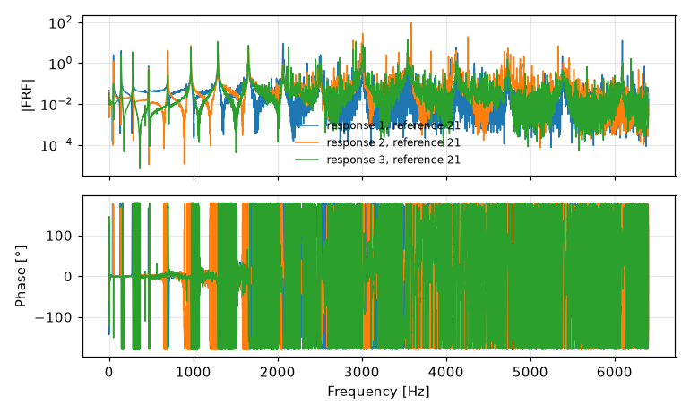

Tutorial
========

The examples use the files in the ``data`` folder of the
`pyuff repository <https://github.com/ladisk/pyuff/tree/main/data>`_.

Reading a file
--------------

Create a :class:`~pyuff.UFF` object for the file and check which data-sets it contains:

.. code-block:: python

    import numpy as np
    import matplotlib.pyplot as plt
    import pyuff

    uff_file = pyuff.UFF('data/beam.uff')
    uff_file.get_n_sets()       # 7
    uff_file.get_set_types()    # array([ 151,  164, 2420, 2411,   58,   58,   58])
    uff_file.get_set_formats()  # 0 for an ASCII and 1 for a binary data-set

The file has a header (151), units (164), coordinate systems (2420), nodes (2411) and three
measured functions (58). Read all data-sets into a list of dictionaries, or only some of
them:

.. code-block:: python

    data = uff_file.read_sets()           # all data-sets: a list
    units = uff_file.read_sets(1)         # one data-set: a dictionary
    frfs = uff_file.read_sets([4, 5, 6])  # selected data-sets: a list

Each dictionary has the key ``type`` with the data-set number; the other keys are the fields
of the data-set (see :doc:`conventions`):

.. code-block:: python

    >>> units
    {'type': 164, 'units_code': 9, 'units_description': 'User unit system', 'temp_mode': 1,
     'length': 1.0, 'force': 1.0, 'temp': 1.0, 'temp_offset': 1.0}

Plotting measured functions
---------------------------

In data-set 58, ``x`` holds the abscissa (here the frequency) and ``data`` the ordinate (here
a complex FRF). The other fields describe the function: e.g. ``rsp_node`` and ``rsp_dir`` give
the response degree of freedom, ``ref_node`` and ``ref_dir`` the reference (excitation):

.. code-block:: python

    fig, (ax1, ax2) = plt.subplots(2, 1, sharex=True)
    for frf in frfs:
        label = f"response {frf['rsp_node']}, reference {frf['ref_node']}"
        ax1.semilogy(frf['x'], np.abs(frf['data']), label=label)
        ax2.plot(frf['x'], np.angle(frf['data'], deg=True))
    ax1.set_ylabel('|FRF|')
    ax2.set_ylabel('Phase [°]')
    ax2.set_xlabel('Frequency [Hz]')
    ax1.legend()
    plt.show()

To read only the description of large data-sets 58, without their values, use
``read_sets(header_only=True)``.

Writing measured functions
--------------------------

A data-set is written from a dictionary. The ``prepare_*`` functions (e.g.
:func:`pyuff.prepare_58` for data-set 58) build the dictionary, check the given values and
document every field (see :doc:`Supported_datasets`). :meth:`~pyuff.UFF.write_sets` writes one
dictionary or a list of them.

The following example writes three measured accelerances, one for each excitation point:

.. code-block:: python

    frequency = np.arange(0, 1001)
    datasets = []
    for i in range(3):
        accelerance = np.genfromtxt(f'data/meas_point_{i + 1}.txt', dtype=complex)
        datasets.append(pyuff.prepare_58(
            func_type=4,                  # frequency response function
            rsp_node=1, rsp_dir=1,        # response: node 1, +X
            ref_node=i + 1, ref_dir=1,    # reference (excitation): node i + 1, +X
            data=accelerance,
            x=frequency,
            id1='Accelerance',
            rsp_ent_name='beam', ref_ent_name='beam',
            abscissa_spacing=1,           # even spacing of the abscissa
            abscissa_spec_data_type=18,   # abscissa: frequency
            ordinate_spec_data_type=12,   # ordinate (numerator): acceleration
            orddenom_spec_data_type=13))  # ordinate denominator: excitation force

    uff_file = pyuff.UFF('measurement.uff')
    uff_file.write_sets(datasets, mode='overwrite')

``mode='overwrite'`` starts a new file; ``mode='add'`` (default) appends the data-sets to an
existing file.

Data-set 58 is written in ASCII with double precision by default:

- ``prepare_58(..., binary=1)`` writes the binary form (58b), which is smaller and faster to
  read;
- ``write_sets(..., force_double=False)`` writes single precision, as given by
  ``ord_data_type`` (2 for real and 5 for complex data).

Writing a geometry and mode shapes
----------------------------------

Nodes (2411), elements (2412) and data at nodes such as mode shapes (55) are written in the
same way. :func:`pyuff.prepare_2412` returns one element; the data-set 2412 groups the elements
by their type (``fe_descriptor``):

.. code-block:: python

    node_nums = np.array([1, 2, 3, 4])
    nodes = pyuff.prepare_2411(
        node_nums=node_nums,
        def_cs=np.zeros(4, int),     # coordinate system of the coordinates
        disp_cs=np.zeros(4, int),    # coordinate system of the displacements
        color=np.ones(4, int),
        x=np.array([0., 1., 1., 0.]),
        y=np.array([0., 0., 1., 1.]),
        z=np.zeros(4))

    quad = pyuff.prepare_2412(
        element_nums=1, fe_descriptor=44,   # plane stress linear quadrilateral
        phys_table=1, mat_table=1, color=1,
        num_nodes=4, nodes_nums=[1, 2, 3, 4])
    elements = {'type': 2412, 44: [quad]}

    mode_shape = pyuff.prepare_55(
        model_type=1,                # structural
        analysis_type=2,             # normal mode
        data_ch=2,                   # 3 DOF translation: 3 values per node
        spec_data_type=8,            # displacement
        load_case=1, mode_n=1, freq=12.5,
        node_nums=node_nums,
        r1=np.zeros(4),                       # X
        r2=np.zeros(4),                       # Y
        r3=np.array([0.1, 0.2, 0.2, 0.1]))    # Z

    pyuff.UFF('model.uff').write_sets([nodes, elements, mode_shape], mode='overwrite')

Data-set 55 is written with as many values per node as response arrays are given: ``r1`` for
scalar data, ``r1`` to ``r3`` for translations, ``r1`` to ``r6`` for translations and
rotations. Complex arrays write complex data (e.g. complex mode shapes).

Copying data-sets between files
-------------------------------

A dictionary read from a file can be written to another file as it is, or after changing some
of its values:

.. code-block:: python

    data = pyuff.UFF('data/beam.uff').read_sets()
    for frf in data[4:]:
        frf['id1'] = 'Beam accelerance'
    pyuff.UFF('beam_copy.uff').write_sets(data, mode='overwrite')
